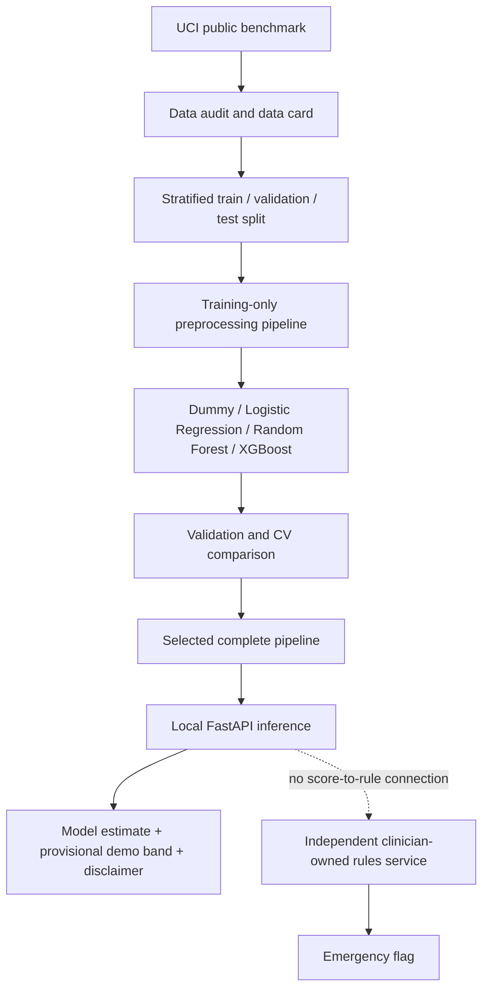

# DJP Heart-Risk Decision-Support — Research/Demo Proof of Concept

> **SAFETY NOTICE:** This is a simulated technical assessment and research demonstration. It is not a medical device, diagnosis, triage system, or patient-facing product. Do not use real patient records. Do not use outputs to make care decisions. The benchmark is not DJP/client data and is not evidence about an Indian population, a clinic, or a deployment cohort.

A reproducible tabular ML experiment implementing the HackBase DJP assignment: public-data audit, leakage-aware preprocessing, baseline + Logistic Regression + Random Forest + XGBoost comparison, validation-based selection, untouched test evaluation, calibration evidence, permutation importance, local FastAPI inference, and a strict separation between ML inference and a clinician-owned emergency-rules interface.

## 1. Scope and non-goals

**Built:** public benchmark ingestion; data dictionary and audit; stratified 60/20/20 train/validation/test split; training-only preprocessing; 5-fold stratified CV on training data; validation-based model selection; complete fitted pipeline persistence; held-out evaluation; calibration and ROC/confusion-matrix plots; permutation importance; API contract; safety stub; tests; run instructions.

**Not built / not authorised:** clinical diagnosis, clinical risk prediction, treatment recommendations, patient-facing wording, emergency criteria, triage, clinical thresholds, live deployment, integration with patient reports, or use of identifiable/restricted records. The API is local demo software only.

## 2. Architecture



The model produces only a statistical benchmark score. The independent rules port accepts a mocked clinician-supplied boolean fixture; it contains no medical logic and does not inspect model probability. The unit test demonstrates that `emergency_flag=True` remains true even if a hypothetical model score is low. Real rules, versioning, patient messages and escalation require qualified clinician approval.

## 3. Dataset, target and provenance

- **Dataset:** UCI Machine Learning Repository, Heart Disease, dataset ID 45; Cleveland subset.
- **Source:** https://archive.ics.uci.edu/dataset/45/heart+disease
- **Retrieval:** downloaded at runtime using `ucimlrepo`; UTC retrieval date, row counts, missingness and quality checks are recorded in `reports/data_audit.json`.
- **Terms:** the UCI page identifies the dataset as CC BY 4.0; attribution is required. Cite Janosi et al. (1989), DOI: https://doi.org/10.24432/C52P4X. Source data are not committed here.
- **Target:** source `num` is transformed into a binary benchmark label (`0` remains 0; any source value 1–4 becomes 1). This simplification loses severity information and must not be mistaken for a clinical definition.
- **Patient identity:** no stable patient identifier is available in this public table. The implementation explicitly states this limitation; it does not invent an ID or claim patient-level separation.
- **Representativeness:** the historical, small Cleveland cohort is not representative evidence for DJP, a clinic, India, or an intended deployment cohort.

Run `djp-audit` to generate a row/column count, duplicate count, per-column missingness, class balance, range checks, limitations, and `reports/data_dictionary.csv`. Check the generated audit and current terms rather than assuming the expected schema/counts.

## 4. Environment setup

Python 3.10–3.13 is supported. From the repository root:

```bash
python -m venv .venv
source .venv/bin/activate          # Windows: .venv\\Scripts\\activate
python -m pip install --upgrade pip
pip install -e ".[dev]"
```

The project uses pinned major-version ranges rather than claiming exact lockfile reproducibility. For a formal handoff, record the exact environment with `pip freeze` after successful installation. XGBoost is included. If it cannot import, the training code records the reason and uses ExtraTrees as a justified tree-ensemble alternative.

## 5. Reproduce the experiment

```bash
# Fetch public data if not already present; produce audit and data dictionary
djp-audit

# Train: 60% train / 20% validation / 20% held-out test
djp-train --seed 42

# Evaluate only the held-out test split (not used in selection)
djp-evaluate

# Permutation importance on held-out data; descriptive only
djp-explain

# Automated tests
pytest -q
```

Equivalent module commands work, e.g. `python -m djp_heart_risk.train`. Generated artifacts:

- `data/raw/cleveland_heart_disease.csv` — locally downloaded public benchmark (not committed).
- `data/test_split.csv` — held-out test partition (not committed).
- `reports/data_audit.json`, `reports/data_dictionary.csv`.
- `reports/model_comparison.csv`, `reports/evaluation.json`.
- `reports/confusion_matrix.png`, `reports/roc_curve.png`, `reports/calibration_curve.png`.
- `reports/permutation_importance.csv`.
- `reports/subgroup_error_review.csv` — descriptive sex/age-band error review with small-cell warnings.
- `configs/training_config.json` — seed, split sizes, selected model and environment versions.
- `models/heart_risk_pipeline.joblib` — complete preprocessing + estimator pipeline (local only).

### Split and leakage discipline

A stratified 60/20/20 split is used. Five-fold stratified CV and candidate fitting occur only on the training partition. Candidate selection uses validation ROC-AUC, with training-CV ROC-AUC as a tie-break. The test set is not used for selection or tuning. Once selected, the pipeline is refit on train + validation and evaluated once on the held-out test split. All imputers, scalers and encoders are fitted within the pipeline on the training partition (and subsequently refit on train+validation for final artefact creation). There is no patient identifier, so patient-level split guarantees are unavailable.

## 6. Models and metrics

Models: prior DummyClassifier baseline, class-weighted Logistic Regression, class-weighted Random Forest, and XGBoost. XGBoost is compared when its dependency is usable; otherwise ExtraTrees is used and the reason is printed. Validation and training-CV evidence are written to `reports/model_comparison.csv`.

Held-out metrics: accuracy, precision, recall/sensitivity, F1, confusion matrix (TN/FP/FN/TP), ROC-AUC when both classes occur, and Brier score. Accuracy alone can hide class-specific errors. False negatives and false positives have different implications; no clinical operating point is chosen here. The demonstration threshold of 0.5 is not clinically selected.

Calibration curve and Brier score are included as descriptive evidence. The test cohort is small, so calibration estimates and bins can be unstable. A good ROC-AUC does not establish calibrated probabilities; a benchmark model score is not a clinically validated probability. If a split has too few examples or only one class, the code records the limitation rather than fabricating a curve/ROC-AUC.

## 7. Prediction API

Train the model first, then start the local API:

```bash
uvicorn djp_heart_risk.api:app --reload --host 127.0.0.1 --port 8000
```

Open `http://127.0.0.1:8000/docs` for the local interactive API documentation. Health check:

```bash
curl http://127.0.0.1:8000/health
```

Synthetic-only request example (not a real person; values are merely a schema demonstration):

```bash
curl -X POST http://127.0.0.1:8000/predict \\
  -H 'Content-Type: application/json' \\
  -d '{"age":52,"sex":1,"cp":2,"trestbps":128,"chol":210,"fbs":0,"restecg":1,"thalach":155,"exang":0,"oldpeak":1.2,"slope":2,"ca":0,"thal":3}'
```

Response contract:

```json
{
  "risk_probability": 0.42,
  "illustrative_band": "MEDIUM",
  "model_version": "djp-heart-risk-1.0.0",
  "pipeline_version": "preprocess-train-v1",
  "disclaimer": "Research/demo output only ...",
  "emergency_flag": null,
  "emergency_rule_source": "independent clinician-rules interface; mock only"
}
```

The probability above is an illustrative response shape, **not a measured result**. Actual response values are generated by the trained artefact. `illustrative_band` uses the brief's provisional project-only bands: LOW `<0.25`, MEDIUM `0.25–0.75` inclusive, HIGH `>0.75`. These are unvalidated assumptions and must never be presented as safe for patient use. Thresholds would require a suitable independent cohort, clinical-owner-defined intended use, prespecified utility/safety analysis, subgroup validation and prospective calibration review.

### Emergency separation

For a unit-test/API demonstration only, the optional `mock_clinician_emergency_flag` request field passes through the separate mock rules port. It is not derived from the ML score. For example, a fixture may supply `true`; the result remains true regardless of model probability. Do not use this mock request field in a real service. Real rule definitions, approval, versioning, access control, audit and escalation are outside this candidate assignment and must be clinician-owned.

## 8. Explainability and monitoring proposal

Permutation importance is computed on the held-out benchmark and saved as a ranked CSV. A descriptive error review by recorded sex and broad age bands reports subgroup counts, recall, precision, false negatives and false positives; small cells are flagged and no fairness or safety claim is made. It describes how predictive performance changes when a feature is shuffled; it does not establish causation. Correlated features can share or mask importance, and small samples make rankings unstable. SHAP is not required for the minimum deliverable; it can be added as a supplementary analysis only with the same caveats.

A future, separately approved monitoring plan would track input-schema failures, missingness, feature drift, prediction distribution, calibration, discrimination and subgroup performance on appropriately governed, consented/authorised data. Use aggregate, minimised telemetry; never log names, IDs, reports or identifiable patient fields. Performance labels arrive only through an approved process. Trigger review on prespecified drift/calibration/performance criteria; clinician governance decides whether to pause, recalibrate or retrain. Retraining requires versioned data approval, reproducible evaluation, independent validation, rollback and clinician sign-off. No automatic retraining or live monitoring is implemented here.

## 9. Security and privacy

No patient data, reports, re-identification keys, credentials or tokens are needed. Do not add them. The API is bound to localhost in the example. Do not expose it publicly. Do not commit `.env`, downloaded data, model binaries, local environments or secrets. Synthetic examples only. Keep all work in research/demo mode.

## 10. Repository map

```text
.
├── README.md
├── pyproject.toml / requirements.txt
├── .gitignore / .env.example
├── data/README.md
├── src/djp_heart_risk/
│   ├── config.py, data.py, audit.py
│   ├── train.py, evaluate.py, explain.py
│   ├── api.py, rules.py
├── tests/
├── configs/ (data, model, training, feature settings)
├── feature_store/ (Feast repo + synthetic data generator)
├── models/README.md
├── reports/README.md
├── scripts/
└── notebooks/ (optional exploration only; not required)
```

## 11. Technical summary and honest limitations

This proof of concept demonstrates a reproducible supervised-learning workflow and a local inference contract. Whether the data support a meaningful experiment must be decided from the generated audit and evaluation evidence. The sample is small and historical, target binarisation is a modelling assumption, patient identifiers are absent, and subgroup/calibration estimates may be underpowered. If results are unstable, that is a valid finding—not a reason to overstate performance. No metrics are embedded in this README; run the pipeline and use the generated reports.

**What worked / did not:** populate this section after running the commands, using the generated audit, model comparison and held-out evaluation. Do not claim a winning model or performance before the run.

## 12. 3–5 minute demo video plan

1. **0:00–0:25:** introduce the research-only task and UCI dataset provenance.
2. **0:25–1:05:** show repository structure, environment setup and commands.
3. **1:05–2:20:** run `/health` and one synthetic `/predict` request; point out probability, provisional band, model/pipeline versions and disclaimer.
4. **2:20–3:20:** show generated model comparison, test metrics, calibration and permutation importance.
5. **3:20–4:20:** explain small historical dataset limitations, one error mode, and why the emergency flag is supplied by an independent clinician-owned rules port.

Upload the recording to an accessible unlisted video/Drive link and replace the placeholder below.

**Demo video:** `ADD_PUBLIC_OR_UNLISTED_VIDEO_URL_HERE`

## 13. Submission checklist

- [ ] Public GitHub repository with source, setup, evidence and documentation.
- [ ] `data/README.md` with exact source, terms review, retrieval date and schema.
- [ ] Generated data audit and data dictionary reviewed.
- [ ] Baseline, Random Forest and XGBoost/justified alternative compared.
- [ ] Test set untouched during selection; metrics/calibration reviewed.
- [ ] Complete pipeline saved/reproducible.
- [ ] API request/response and tests pass.
- [ ] Emergency rule separation test passes.
- [ ] Technical summary updated with actual generated findings.
- [ ] 3–5 minute demo link added and access verified.
- [ ] No private data, secrets, or restricted dataset files committed.

The assignment asks for submission within five calendar days of receipt; confirm the deadline in the original email.

## Streamlit interface

The Streamlit dashboard is a UI client for FastAPI. It sends synthetic/non-identifiable feature values to `POST /predict` and displays the model estimate, provisional demo band, version metadata, and independently supplied mock emergency flag. It does not load the model or implement clinical rules.

### Run locally

```bash
pip install -e ".[dev,ui]"
uvicorn djp_heart_risk.api:app --reload --host 127.0.0.1 --port 8000
```

In another terminal:

```bash
streamlit run app/streamlit_app.py
```

Open `http://localhost:8501`. Set `DJP_API_URL` to change the API address.

## Docker and Docker Compose

Docker packages the project for the API and dashboard. FastAPI is exposed on port `8000`; Streamlit is exposed on port `8501`. Model, report, and configuration folders are mounted from the host so artifacts persist.

### Build and train

```bash
docker compose build
docker compose --profile training run --rm trainer
```

The training profile audits the public benchmark, trains/selects using validation evidence, and runs evaluation and explainability. Dataset retrieval requires container network access. A successful run writes the pipeline to `models/` and evidence to `reports/`.

### Start the API and dashboard

```bash
docker compose up -d api streamlit
docker compose ps
```

- Streamlit: `http://localhost:8501`
- FastAPI docs: `http://localhost:8000/docs`
- API health: `http://localhost:8000/health`

Stop with `docker compose down`. Do not expose these research/demo services publicly.

### Troubleshooting

- Dashboard cannot connect: inspect `docker compose ps` and `docker compose logs api`.
- API returns HTTP 503: run the training profile and confirm `models/heart_risk_pipeline.joblib` exists.
- UCI retrieval fails: check container network access and dataset terms; never substitute patient data or undocumented sources.


## MLOps observability extensions

The local Compose stack also includes optional MLflow experiment tracking, Prometheus metrics scraping, and Grafana dashboards. Start the stack with `docker compose up -d --build api streamlit mlflow prometheus grafana`. Interfaces: Streamlit `http://localhost:8501`, FastAPI `http://localhost:8000`, MLflow `http://localhost:5000`, Prometheus `http://localhost:9090`, Grafana `http://localhost:3000`. Set `GRAFANA_ADMIN_PASSWORD` in `.env` before exposing Grafana beyond localhost.

Set `MLFLOW_TRACKING_URI=http://mlflow:5000` when running `djp-train` to log selected-model parameters, validation metrics, comparison report and sklearn model artifact. Training still saves the local joblib artifact if MLflow is unavailable.

### Feature Store decision

Feast integration is intentionally not enabled for the current UCI Cleveland snapshot: it has no stable entity key or trustworthy longitudinal event timestamps. Inventing these would create misleading point-in-time semantics. See `feature_store/README.md`. Add Feast only when a legitimate source provides entity keys and event-time data.

### Streamlit Community Cloud

For a Streamlit Community Cloud frontend, use the root `requirements.txt` dependency manifest expected by Community Cloud, set `DJP_API_URL` in Streamlit Secrets to the public HTTPS FastAPI URL, and host FastAPI/MLflow/Prometheus/Grafana separately. Community Cloud does not run this Docker Compose stack. `requirements-cloud.txt` is a reference manifest; Community Cloud does not automatically discover that filename.

### Dependency installation

- Streamlit Community Cloud reads the root `requirements.txt`; it is intentionally kept to frontend/runtime dependencies.
- `requirements-cloud.txt` is the matching reference copy. Community Cloud does not auto-discover this alternate filename.
- Docker installs the package extras from `pyproject.toml` (`.[ui,mlops]`).
- Local development: `pip install -e '.[dev,ui,mlops]'`.

## Configuration, public data, and Feast Feature Store

Configuration examples live in `configs/`:
- `data.yaml`: public UCI Cleveland dataset provenance and target.
- `model.yaml`: candidate models, selection metrics, and calibration policy.
- `training.yaml`: split, cross-validation, seed, and artifact paths.
- `features.yaml`: Feast demo entity, event timestamp, stores, and synthetic-only safety boundary.

The existing Cleveland dataset remains the public source for model training. It is cross-sectional and lacks a trustworthy longitudinal entity key and event timestamp, so it is **not** falsely represented as Feast-ready. A separate Feast repository under `feature_store/feature_repo/` uses explicitly synthetic longitudinal records. Run it with `docker compose --profile features run --rm feature-store-demo` after the project image has been built. See `feature_store/README.md` for details. Synthetic records are not used to train the Cleveland model and are not clinically meaningful.
